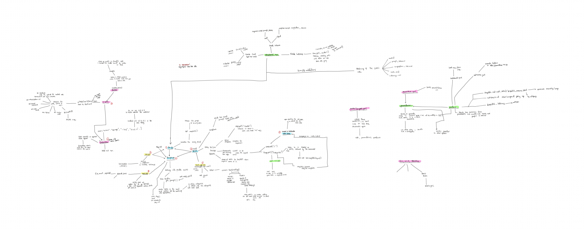

# dispatch-first



Reads customer emails, sorts them, and drafts the easy replies, so the humans can handle the hard ones.

I built this as a learning project to understand what it takes to run an AI feature properly: not just calling a model, but testing it, watching it, and putting guardrails around it. The pretend customer is a small bike repair shop that gets the same handful of questions every day.

**Live:** _add your Render URL here_

---

## What it does

Paste a customer email into the page and click **Categorize Email**. dispatch:

1. **Sorts it** into one of six categories: `booking`, `status`, `pricing`, `hours`, `complaint` or `other`
2. **Drafts a reply** using only the facts in the shop's FAQ (`faq.md`)
3. **Never drafts a reply to a complaint.** Those are flagged `requires_human: true` so a person handles them

```json
{
  "category": "pricing",
  "requires_human": false,
  "reply": "Thanks for reaching out! A standard tune-up is $75..."
}
```

---

## How a request flows

```
Browser (templates/index.html)
   │  POST /categorize  {"email": "..."}
   ▼
app.py ── starts a Langfuse trace
   │
   ├─► prompts.py → get_prompt(email)            email wrapped in <customer_email> tags
   ├─► llm.py     → complete(prompt)             AI call #1: one-word category
   │
   ├─► guardrail: complaint?  → requires_human = True, no reply
   │              otherwise   → load faq.md → get_reply_prompt() → complete()   AI call #2
   │
   └─► telemetry: Prometheus counters + a one-line JSON log
       → returns {category, requires_human, reply}
```

### Routes

| Route | What it does |
|---|---|
| `GET /` | The page |
| `POST /categorize` | Sorts an email and drafts a reply |
| `GET /health` | Health check for Render |
| `GET /metrics` | Prometheus metrics |

### Files

| File | Its one job |
|---|---|
| `app.py` | The web routes, the complaint guardrail, metrics and logging |
| `prompts.py` | The categories, the prompt version and both prompts |
| `llm.py` | Talks to Groq; records tokens, cost and latency for each request |
| `faq.md` | The shop's facts that replies are allowed to use |
| `eval.py` + `evals/dataset.jsonl` | Grades the **real** model against 45 labelled emails |
| `test_app.py` | Fast tests with the model faked |
| `Dockerfile` | Packages the app; runs as a non-root user |
| `docker-compose.yml` + `ops/` | Runs the app with Prometheus and Grafana locally |

---

## Testing the AI two different ways

These answer two different questions, so they're kept separate.

**`test_app.py`: does my code work?**
The model is faked with `unittest.mock.patch`, so the tests are fast, free and don't need an API key. They check the health route, a normal email, the complaint guardrail and the metrics route.

**`eval.py`: is the model any good?**
Calls the real model on 45 labelled emails, including edge cases and prompt-injection attempts ("ignore your instructions and…"). CI fails if accuracy drops below **85%**.

**Latest eval:** _XX/45 (XX%). Run `python eval.py` and paste the result here._

---

## Watching it run

All three kinds of observability, for different questions:

| Tool | Question it answers |
|---|---|
| **JSON logs** | "What happened on this one request?" One line per request: category, tokens, cost, latency, prompt version |
| **Prometheus + Grafana** | "What's happening overall?" Emails by category, tokens, total cost and latency, on a 4-panel dashboard |
| **Langfuse** | "Why did the model answer that?" The exact prompt and output for both AI calls, grouped under one trace |

Prometheus also has two alert rules (`ops/alerts.yml`): **HighLLMLatency** (over 3 seconds) and **ComplaintSpike** (3 or more complaints).

Cost is calculated from Groq's listed price for `openai/gpt-oss-120b`: $0.15 per million input tokens and $0.60 per million output tokens.

---

## Design decisions

**Two AI calls instead of one.** The first call only sorts the email, so the guardrail can stop *before* a complaint reply is ever written. The cost is roughly double the tokens and latency on non-complaint emails. If speed mattered more, I'd try one call with structured output, and check complaint recall stays at 100%.

**Mocked tests and real evals, separately.** Tests check my Python, evals check the model. Mixing them would make tests slow, flaky and expensive.

**Prometheus pulls instead of the app pushing.** If Prometheus goes down, the app keeps working; metrics are just missed for a while.

**Plain HTML instead of React.** One text box and one button didn't justify a frontend build step.

**`temperature=0`.** Sorting should give the same answer for the same email.

---

## Run it locally

You'll need Python and a [Groq](https://console.groq.com/keys) API key. Langfuse keys are optional, for tracing.

```bash
python3 -m venv .venv
source .venv/bin/activate
pip install -r requirements.txt
```

Create a `.env` file:

```
GROQ_API_KEY=your_groq_key
LANGFUSE_PUBLIC_KEY=your_langfuse_public_key
LANGFUSE_SECRET_KEY=your_langfuse_secret_key
LANGFUSE_HOST=https://cloud.langfuse.com
```

Start the app:

```bash
uvicorn app:app --reload
```

Open http://127.0.0.1:8000.

**Or run everything with monitoring:**

```bash
docker compose up --build
```

| Service | Address |
|---|---|
| dispatch | http://localhost:8000 |
| Prometheus | http://localhost:9090 |
| Grafana | http://localhost:3000 (admin / admin, local only) |

### Tests and evals

```bash
pytest -v          # fast, no API key needed
python eval.py     # calls the real model, needs GROQ_API_KEY
```

### CI

GitHub Actions runs on every push: install, lint, `pytest`, a Docker build, and `eval.py`. The eval step needs `GROQ_API_KEY` added as a repository secret.

---

## Known limitations

I'm stopping this project here and moving on, so these are written down rather than fixed. Each one taught me something.

- **Metrics can mix up requests under concurrent traffic.** `llm.LAST_CALL_META` is one dictionary shared by every request, and FastAPI runs plain `def` routes on a thread pool, so two overlapping requests can reset or add to each other's numbers. The fix is to have `complete()` return its usage, and add it up in local variables inside the route.
- **Logs include the full email and reply.** Real customer emails contain personal details, and logs shouldn't. A production version would log only metadata: category, tokens, cost, latency and email length. Langfuse traces also store full text.
- **No limit on email size or request rate.** Anyone could send huge emails in a loop and run up the API bill. The fix is a max length on the request model plus a per-visitor rate limit.
- **No timeout or error handling around Groq.** It uses the client defaults, and a Groq failure becomes a plain 500. A real version needs a short timeout, retries with a limit, and clear 502/503/504 errors.
- **The eval runs on every push.** 45 real API calls at once can hit Groq's free-tier rate limit and fail CI for no real reason. It should only run when the prompts, FAQ or dataset change.
- **85% overall accuracy can hide a missed complaint.** The guardrail depends on complaints being caught, so complaint recall should have its own gate at 100%.
- **Prometheus and Grafana use `:latest` images.** They should be pinned to specific versions so the setup doesn't change by itself.

---

## What I learned

- An AI can generate a whole working stack. Finding what's *wrong* with it (shared state, private data in logs, unbounded cost) is the part that takes judgment.
- Tests and evals answer different questions, and you need both.
- Logs, metrics and traces each answer a different question about the same request.
- A guardrail is only as good as the measurement behind it.

---

## Stack

Python · FastAPI · Groq (`openai/gpt-oss-120b`) · Pydantic · pytest · Docker · Docker Compose · Prometheus · Grafana · Langfuse · GitHub Actions · Render